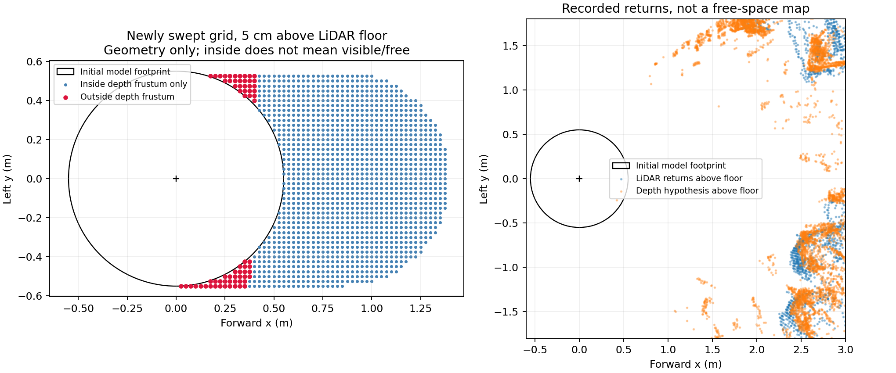

# 头部深度相机与胸部雷达：离线几何核对

2026-10-19，机器人保持 `live=false`，三个覆盖标志 false，没有发运动指令、
启用驱动点云、修改相机参数或重启定位。结论是：**毫米尺度假设及现有 TF
与本次雷达数据基本一致，值得继续做深度障碍观测；尚不能作为全覆盖依据。**

## 输入与尺度核对

在机器人本机接收原始深度，保存后传回开发机。深度 frame 为
`rgbd_depth_head_front`，1280×720、16UC1；相机内参 fx=fy=624.496，
cx=638.5、cy=360.5，plumb_bob 畸变参数全零。驱动实读
`enable_depth_scale=true`，flip/mirror=false，rotation=-1，未启用 point cloud。
编码与该开关本身不证明单位，分析显式传入 `--depth-scale .001`。

约 8.64 s 内采到三组配对，时间戳相差 6.87–11.69 ms；分别使用两传感器
精确时刻的 odom TF，再统一到深度时刻、去偏航后的骨盆参考系。
雷达地面拟合使用双踝约束，残差 p95 约 1.65–1.68 cm。
保留采集初期 TF 外推失败，未将失败帧记为有效输入。

每组约 10515–10543 个雷达点投影到有正深度值的像素。轴向距离差绝对值
中位数为 2.33–2.42 cm，p90 为 16.57–17.53 cm，p95 为 35.99–39.71 cm。
深度/雷达轴向距离比中位数 0.9909–0.9917。采用现有 TF 直接投影，未加
坐标轴翻转；反例翻转相机 XY 后，落到雷达拟合地面以下 5 cm 的深度样点比例
从约 5.05–5.59% 增至约 49%。不删除这些地面以下点以改善统计。

以上是同一姿态、同一场景的跨传感器一致性检查，不能排除共同偏差，不能
替代不同距离/姿态的外参标定、深度边缘与遮挡检查，也不能证明大理石反光
是所有异常点的原因。没有把 2.4 cm 的中位差解释为全域测距精度。

## 近身几何缺口

诊断圆半径取当前安全门 0.40+0.15=0.55 m，直线位移模型取 0.60 m 加
0.25 m 停车余量，共 0.85 m。该模型只是解释已有参数的几何示例，**不是
已测得的人形机器人步态/脚部扫掠包络**。采样间隔 2.5 cm，排除初始圆内
区域，只统计新扫过区域，1495 个 XY 点。结果如下：

| 离拟合地面高度 | 投影在深度画面内 | 画面外点数 |
| --- | --- | --- |
| 5 cm | 95.45–95.52% | 67–68 / 1495 |
| 20 cm | 96.72–96.79% | 48–49 / 1495 |
| 60 cm | 98.53% | 22 / 1495 |
| 100 cm | 32.51–32.78% | 1005–1009 / 1495 |

低处缺口主要在近身前侧两边，向前约 0.03–0.40 m、横向约 ±0.4–0.55 m。
**画面内仅表示几何视锥包含，不表示深度有效、无遮挡、满足最近测距或空闲。**
这个百分比不能作为覆盖验收值；胸部雷达能否补齐缺口尚未建立联合可见性
证据，也不能从“没有回波”推断它能看见该处。



左图蓝点只在视锥内，红点在视锥外；右图只画已观测物体表面，空白不作
空闲空间解释。图中圆不是实际双脚或身体边界。

## 可复现工具与后续边界

新增 `tools/analyze_depth_lidar_pairs.py`，离线读取 NPZ，无 ROS 或运控依赖。
内参不合法、带 skew、非刚体或反射变换会拒绝；画面背后、边界外和非有限
目标不计入视锥。合成已知像素/距离/旋转平移目标等 9 项测试通过：

```bash
ROS_DOMAIN_ID=42 tools/run_tests.sh src/sztu_navigation/test/test_depth_pair_analysis.py -q
```

原始配对与采集脚本保存在开发机、机器人诊断目录，具体路径、大小和 SHA256
见 [manifest](depth_lidar_manifest.json)，离线数值与分析器哈希见
[分析结果](depth_lidar_analysis.json)。复现时选未占用的输出路径，命令为：

```bash
python3 tools/analyze_depth_lidar_pairs.py \
  ~/.local/state/sztu-nav-diagnosis/20261019_coverage/depth_lidar_pair_{0,1,2}.npz \
  --depth-scale .001 --output /tmp/depth_review_new.json --plot /tmp/depth_review_new.png
```

下一段实现应先做独立的深度障碍影子观测，拒绝过期图像、标定不匹配或
精确时刻 TF 不可用的输入；不把深度缺失转为空闲，不直接打开三个覆盖标志。
在联合可见性和人形步态包络未核实前，不能据此放行自主行走或原地旋转。
另一条独立工作是受控、只发零速的 SDK/RC 仲裁检查；它仍不能证明物理停止。
无需重复已完成的椅子摆放对照。
