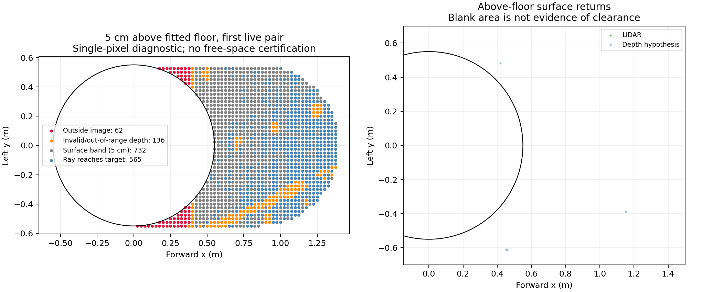

# 深度影子观测：实机结果

2026-10-19，在机器人本机运行独立诊断，未设置导航目标或发送运动指令，
未重启FAST-LIO、AMCL或导航。四次只读快照均为 `live=false`、三个覆盖
标志false，`sztu-bridge` inactive；这些快照中收到的cmd_vel和rc硬件指令
均为零。它们不是整轮连续运动监测或物理停住的证明。

## 实现与软件验证

新增[影子观测工具](../../../../tools/depth_obstacle_shadow.py)及冻结相机profile，
用精确时刻TF统一深度/雷达坐标，每组重新估计双踝约束地面。
拒绝标定变化、布局错误、过期/乱序/未来数据、时间差超限与精确TF缺失，
只保存JSON及最多三组原始配对，不发布安全扫描、TF、速度或覆盖标志。
使用方式与诊断边界见[说明](../../../../docs/depth_obstacle_shadow.md)。

域42的布局、已知几何正反例和ROS集成检查共32项通过（10.93 s）。
集成检查包括正确输入产出观测、相机配置不符无观测、内参变化/过期图像/
停止TF后拒绝，以及没有控制或安全扫描发布者。三组实机原始配对离线重算，
标签与计数完全一致，浮点量按绝对误差1e-12比较一致。

首轮版本 `3fcb699` 得到0组观测，136次校验拒绝。原因是工具误把
`roi.do_rectify=true` 当作裁剪。实读ROI宽高为0、零畸变、R=I、P=[K|0]，
按Humble消息定义为全图且投影不变；修正工具，未修改相机参数。
该历史结果和原CameraInfo保留，增加全图提示/真实裁剪反例后，使用
`6f68378` 新开第二轮，没有覆盖失败报告。

## 第二轮30秒观测

收到719张深度、703条CameraInfo、296帧雷达；58组生成有效观测。
深度和CameraInfo各拒绝9条时间戳；79次精确TF或处理尝试未成功，所保存
前8个错误均是TF未来外推，涉及base_link或lidar_chest_front至odom。
这些计数是诊断尝试次数，不能当作独立丢帧数或传感器硬件故障率。
另有2次处理后过期、2次配对时间差拒绝；未采用最新TF或放宽年龄限制。
运行前后相机驱动的尺度、翻转、旋转、分辨率等参数均与冻结profile匹配。

有效深度/雷达时差0.46–28.71 ms，中位7.32 ms；深度/内参时差最大33.37 ms。
记录时输入有效年龄最大0.447 s。连续有效观测的传感器时刻间隔中位0.367 s、
最大2.670 s，**不能用于持续有效的安全控制输入**。下一项软件工作应在
0.5 s既定期限内完善等待精确TF和选择可处理配对的调度，并重新量化间隔，
而不是扩大过期窗口或把旧观测重复当新观测。

## 看到什么、还缺什么

保持原诊断模型：半径0.55 m、前移加停车余量0.85 m，每层1495个新扫掠
XY点。它不是实测的人形身体/双脚包络。下列数值是各组的最小–最大：

| 离地高度 | 在画面外 | 对应无效深度 | 超诊断距离 |
| --- | --- | --- | --- |
| 5 cm | 60–63 | 123–135 | 1–3 |
| 20 cm | 46 | 106–124 | 1–5 |
| 60 cm | 23–24 | 66–90 | 5–12 |
| 100 cm | 996–1017 | 57–85 | 4–13 |

其余类别是表面容差带或测距射线到达目标，不代表完整空间可通行；单像素
比较没有消除反光、遮挡边缘、测量/标定误差。低处画面外区域仍在近身两侧。

前向x=0–1.4 m、y=±0.55 m、离地0.05–1.8 m内，4像素步长的深度采样
每组仅0–3点（中位1点）、0–3个5 cm栅格；同ROI雷达表面格为0。
这是零星回波差异，未独立确认它们是障碍、反光还是自身结构，不能称为
已经填补雷达盲区；更不能把其余空白认作空地。过滤后深度点落在拟合地面
以下5 cm的比例仍为3.79–4.77%，保留报告，不调高地面阈值来消掉统计。

原始观测、失败轮、三组NPZ、运行脚本、只读参数与流量快照保存在两机
`~/.local/state/sztu-nav-diagnosis/20261019_depth_shadow/`，哈希、数值、工具
版本及重算检查见[摘要](depth_shadow_summary.json)。

当前完成的是运行时观测及可复现诊断；深度尚未融合进安全门或代价地图。
现有数据不消除视野缺口、量化身体扫掠、建立独立标定或地面停车/遥控接管
证据，`hardware_coverage_verified=false`。导航继续保持 `live=false`，
三个覆盖标志均false。此次新增的是直接执行的工具与诊断资料，无需编译
运行中节点或重启定位。
